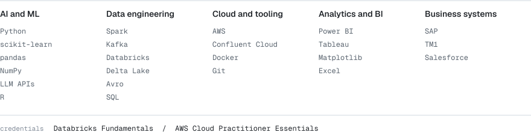

<picture>
  <source media="(prefers-color-scheme: dark)" srcset="assets/hero-dark.svg">
  
</picture>

[Portfolio](https://tasnimrh.github.io) | [LinkedIn](https://www.linkedin.com/in/tasnimhassan/) | [Email](mailto:tasnim.hassan@mail.mcgill.ca) | [Resume](https://tasnimrh.github.io/Tasnim_Hassan_Resume.pdf)

<a href="https://tasnimrh.github.io/work/olist-late-delivery/">
  <picture>
    <source media="(prefers-color-scheme: dark)" srcset="assets/olist-dark.svg">
    
  </picture>
</a>

[My notebook](https://github.com/JustJay7/olist-late-delivery/blob/main/notebooks/05_fine_tune.ipynb) | [Team repository](https://github.com/JustJay7/olist-late-delivery) | [Case study](https://tasnimrh.github.io/work/olist-late-delivery/) | McGill Enterprise Data Science, team of seven

<a href="https://tasnimrh.github.io/work/skillguard/">
  <picture>
    <source media="(prefers-color-scheme: dark)" srcset="assets/skillguard-dark.svg">
    
  </picture>
</a>

[Code](https://github.com/JustJay7/skillguard) | [Demo video (2:44)](https://youtu.be/eZ9NVyEEMAI) | [Case study](https://tasnimrh.github.io/work/skillguard/) | Built with [Jay Malhotra](https://github.com/JustJay7) for the Nebius x NVIDIA Global AI Hackathon

### In progress

<table>
  <tr>
    <td><b>Origin</b></td>
    <td><b>Atlassian Codegeist 2026, project lead.</b> A Jira and Bitbucket app that traces a fixed bug back to the pull request that introduced it, then suggests the affected releases and any maintained branches still missing the fix. Nothing is written to Jira until a person confirms.</td>
  </tr>
  <tr>
    <td><b>Novartis&nbsp;capstone</b></td>
    <td><b>McGill MMA, team lead and solutions architect.</b> AI-powered sales analytics for Novartis Pharma Canada: HCP segmentation, territory optimization and field activity insights in one dashboard.</td>
  </tr>
</table>

### Experience and education

- **Informa Connect**, London: Finance Analyst, Interim Business Controller and Graduate Finance Analyst (2022 to 2025). Month-end reporting for a £70M portfolio, a 3-day IFRS close for a £30M unit, forecast accuracy up 15%.
- **Assembly Global (Stagwell)**, London: Finance Associate (2022)
- **KPMG UK**, London: Consulting Summer Intern (2021)
- **McGill University**, Master of Management in Analytics (2026 to 2027), GPA 4.0
- **De Montfort University**, BA (Hons) Business Management and Finance, First-Class Honours

<picture>
  <source media="(prefers-color-scheme: dark)" srcset="assets/toolkit-dark.svg">
  
</picture>

Open to roles in data science, technology consulting, strategy and digital transformation. See the case studies on my [portfolio site](https://tasnimrh.github.io), or reach me on [LinkedIn](https://www.linkedin.com/in/tasnimhassan/).
