<picture>
  <source media="(prefers-color-scheme: dark)" srcset="assets/hero-dark.svg">
  
</picture>

**[Portfolio](https://tasnimrh.github.io)** &nbsp;·&nbsp; [LinkedIn](https://www.linkedin.com/in/tasnimhassan/) &nbsp;·&nbsp; [Email](mailto:tasnim.hassan@mail.mcgill.ca) &nbsp;·&nbsp; [Resume](https://tasnimrh.github.io/Tasnim_Hassan_Resume.pdf)

 

<a href="https://tasnimrh.github.io/work/brand-pulse/">
  <picture>
    <source media="(prefers-color-scheme: dark)" srcset="assets/brandpulse-dark.svg">
    
  </picture>
</a>

[Code](https://github.com/tasnimrh/brand-pulse) · [How it differs](https://github.com/tasnimrh/brand-pulse#how-this-differs-from-the-usual-version) · [Case study](https://tasnimrh.github.io/work/brand-pulse/) · Kafka, Avro, PySpark, Databricks, Delta Lake · solo

<a href="https://tasnimrh.github.io/work/skillguard/">
  <picture>
    <source media="(prefers-color-scheme: dark)" srcset="assets/skillguard-dark.svg">
    
  </picture>
</a>

[Code](https://github.com/JustJay7/skillguard) · [Demo (2:44)](https://youtu.be/eZ9NVyEEMAI) · [Case study](https://tasnimrh.github.io/work/skillguard/) · built with [Jay Malhotra](https://github.com/JustJay7), Nebius x NVIDIA Global AI Hackathon

<a href="https://tasnimrh.github.io/work/olist-late-delivery/">
  <picture>
    <source media="(prefers-color-scheme: dark)" srcset="assets/olist-dark.svg">
    
  </picture>
</a>

[My notebook](https://github.com/JustJay7/olist-late-delivery/blob/main/notebooks/05_fine_tune.ipynb) · [Team repository](https://github.com/JustJay7/olist-late-delivery) · [Case study](https://tasnimrh.github.io/work/olist-late-delivery/) · McGill Enterprise Data Science, team of seven

Also: [Kafka to Spark, verified](https://github.com/tasnimrh/kafka-spark-streaming), a 2022 streaming pipeline rebuilt on Confluent Cloud and Databricks, 32 of 32 events landed exactly once.

### How I work

<table>
  <tr>
    <td width="30%"><b>Real data is the test.</b></td>
    <td>Brand Pulse passed 45 unit tests, then live data broke it three ways: bot traffic, song links counted as mentions, and streams that never ended. I found each one by reading the evidence, and measured each fix.</td>
  </tr>
  <tr>
    <td width="30%"><b>A metric should price the decision.</b></td>
    <td>The Olist model is judged on what operations pays: 6.8 reviews for every late order caught, against 24 at random. Not just a model score.</td>
  </tr>
  <tr>
    <td width="30%"><b>Trust behaviour, not labels.</b></td>
    <td>A static scanner rated an AI skill safe. Run in a sandbox, it tried to read 13 private files. SkillGuard watches what code does.</td>
  </tr>
  <tr>
    <td width="30%"><b>Build for the person who acts on it.</b></td>
    <td>I spent four years handing numbers to a CFO and the heads of seven cost centres. I know which outputs get used and which get ignored, so I build for the first kind.</td>
  </tr>
</table>

### In progress

<table>
  <tr>
    <td><b>Origin</b></td>
    <td><b>Atlassian Codegeist 2026, solo builder.</b> A Jira and Bitbucket app that traces a fixed bug back to the pull request that introduced it, then suggests the affected releases and any maintained branches still missing the fix. Nothing is written to Jira until a person confirms.</td>
  </tr>
  <tr>
    <td><b>Novartis&nbsp;capstone</b></td>
    <td><b>McGill MMA, team lead and solutions architect.</b> AI-powered sales analytics for Novartis Pharma Canada: HCP segmentation, territory optimization and field activity insights in one dashboard. I lead the architecture and the client meetings.</td>
  </tr>
</table>

### Background

- **McGill University, Desautels**: Master of Management in Analytics (2026 to 2027), GPA 4.0
- **Informa PLC**, London (2022 to 2025): three roles in commercial finance, including Interim Business Controller. Reported on a £125M+ revenue portfolio, ran a 3-day close, improved forecast accuracy by 15%.
- **KPMG UK**, London (2021): Consulting Summer Intern, benchmarking and market analysis for client transformation work
- **Assembly Global (Stagwell)**, London (2022): Finance Associate
- **De Montfort University**: BA (Hons) Business Management and Finance, First-Class Honours

<picture>
  <source media="(prefers-color-scheme: dark)" srcset="assets/toolkit-dark.svg">
  
</picture>

Based in Montreal. Always glad to talk data platforms, applied AI, or the decisions they feed: [LinkedIn](https://www.linkedin.com/in/tasnimhassan/) or [email](mailto:tasnim.hassan@mail.mcgill.ca).
